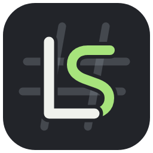

# LightSharp



**LightSharp** is a lightweight, native desktop C# and .NET code editor built with Avalonia. It aims to bring a Visual Studio-inspired workflow to a fast, focused IDE prototype without Electron, Node.js, or an extension host.

> LightSharp is an early-stage project. The core editing workflow is in place, while several advanced IDE features are still on the roadmap.

## Features

- Open solution files (`.sln`, `.slnx`) or a workspace folder.
- Browse projects and files in Solution Explorer, with the active editor file revealed automatically.
- Create a .NET project or add a new file from the IDE.
- Edit multiple files in tabs, with dirty-state indicators and save prompts before closing unsaved documents.
- C# syntax highlighting, semantic coloring, inline diagnostics, and error underlines.
- Roslyn-powered completion, method information, missing-`using` actions, and C# formatting.
- Build, run, test, and stop .NET commands from the toolbar; inspect Problems, Output, and Tests panels.
- Basic Git workflow: initialize a repository, view changes, stage all, and commit.
- Dockable IDE panels and Visual Studio-style keyboard shortcuts.

## Technology

- C# on .NET 10
- Avalonia 12 and AvaloniaEdit
- Roslyn for C# language services
- Dock.Avalonia for IDE panel layout

## Requirements

- .NET 10 SDK
- Git for Git features

## Run

```bash
dotnet restore
dotnet run --project src/LightSharp/LightSharp.csproj
```

## Build

```bash
dotnet build LightSharp.slnx
```

## Project structure

- `src/LightSharp/MainWindow.axaml` and `MainWindow.axaml.cs` — main IDE shell and interaction handlers.
- `src/LightSharp/Services/WorkspaceService.cs` — workspace and solution tree loading.
- `src/LightSharp/Services/CSharpCompletionService.cs` — Roslyn language services.
- `src/LightSharp/Services/DotNetService.cs` — build, run, and test process management.
- `src/LightSharp/Services/GitService.cs` — Git status and basic repository operations.
- `src/LightSharp/Styles/` — shared UI styles, color palette, and editor highlighting configuration.
- `src/LightSharp/Assets/` — LightSharp app icon in SVG, PNG, and Windows ICO formats.

## Current limitations

LightSharp is not yet a full Visual Studio replacement. Full debugging with breakpoints and variable inspection, solution-wide search and replace, richer Git diff/history workflows, persistent editor preferences, and broader Roslyn refactorings are planned.

## Design principles

- Keep the app lightweight and responsive.
- Run filesystem and process work asynchronously.
- Avoid polling the workspace.
- Make language analysis incremental and cancellable where possible.
- Keep visual styles and editor color settings in separate resource files.